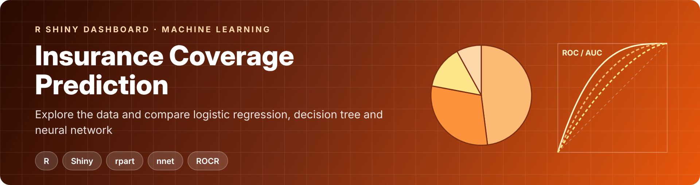
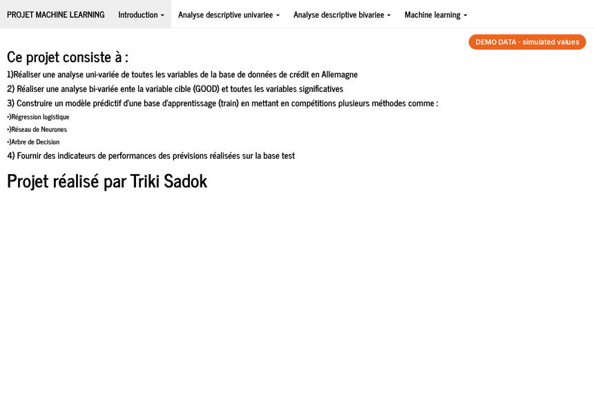

<p align="center">
  
</p>

🎓 *Academic project, completed during my university studies.*

An interactive **R Shiny** dashboard to explore an insurance coverage dataset and compare three machine learning models: logistic regression, decision tree and neural network. The interface is in French.

<p align="center">
  
</p>

<p align="center"><sub>The screenshots use simulated demo data, not the original dataset.</sub></p>

## Features

- **Univariate analysis:** pie charts, box plots and summary statistics
- **Bivariate analysis:** box plots and mosaic plots against the target, with t-test, Fisher and chi-squared tests
- **Correlation matrix** of all variables
- **Three models** trained on 75% of the data and tested on the other 25%
- **ROC curves and AUC** to compare the models side by side

## Built with

R · Shiny · shinythemes · rpart · nnet · ROCR · corrplot

## How to run

```r
install.packages(c("shiny", "shinythemes", "shinydashboard", "readxl", "dplyr", "ggplot2", "plotly",
                   "corrplot", "caret", "ROCR", "pROC", "rpart", "rpart.plot", "randomForest",
                   "nnet", "NeuralNetTools", "e1071"))
```

Put `couverture-dassurance.xlsx` next to `app.R`, then open `app.R` in RStudio and click **Run App**.

## Author

**Sadok Triki** · [LinkedIn](https://www.linkedin.com/in/trikisadok) · [GitHub](https://github.com/TrikiSadok)
